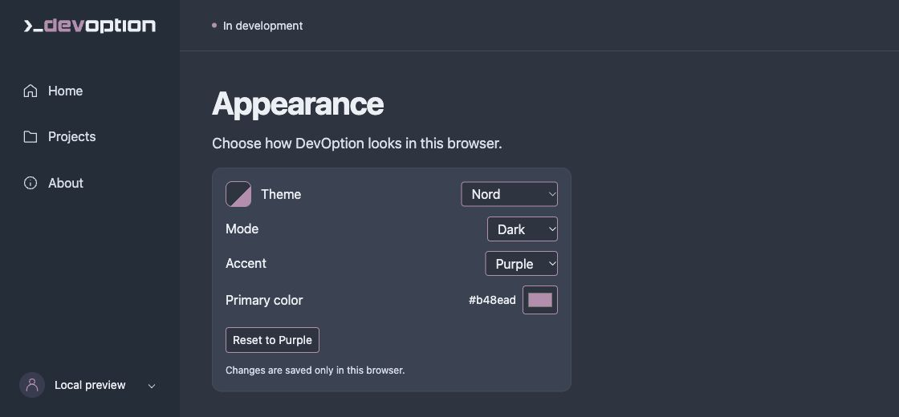
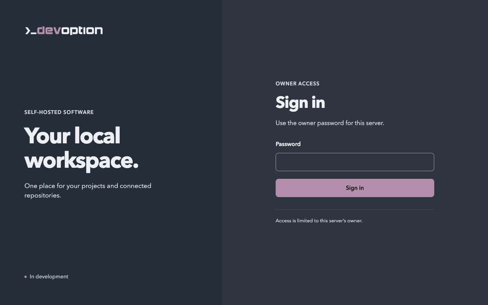
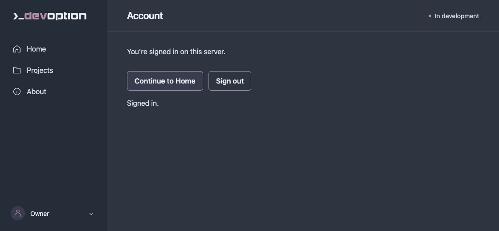

# DevOption

DevOption is an open-source project working toward a self-hosted software factory:
a place to build, test, and run software.

It currently provides Home and About placeholders, saved projects and an empty-project creation form
for configured owners, browser-local Appearance settings, and owner sign-in/sign-out.
Repository registration, builds, and deployments are not implemented yet. There is
no published release.

## Try it locally

You need Git, Rust **1.99.0**, and your operating system's C build tools/linker.
The [Rust installation guide](https://www.rust-lang.org/tools/install) covers setup;
`rustup` uses the version pinned in this repository. Initial setup requires internet
access to download the toolchain and dependencies.

```sh
git clone https://github.com/devoption/devoption.git
cd devoption
cargo fetch --locked
cargo run --locked --offline -- serve
```

Open [127.0.0.1:3000](http://127.0.0.1:3000/). Use the profile menu to open
Appearance settings. Press **Ctrl+C** in the terminal to stop the server.
Run `cargo run --locked --offline -- --help` for command options.

On Unix, `serve --data-dir /absolute/private/directory` optionally validates an
existing owner-data directory before listening. It must belong to the current OS
user, have no group/other permission bits, and use a path with no symlink components
or `..`. Invalid owner records stop startup. This option retains the opened
directory but creates no directories or accounts and changes no permissions.
When a valid owner already exists at startup, it enables the HTTP sign-in and
sign-out routes described below. A missing owner leaves them closed. Without this
option, the preview selects no data path.

### Create the first owner locally or over SSH

On Unix, run the following on the server as the unprivileged OS account that will
run DevOption, after preparing an existing private data directory:

```sh
cargo run --locked --offline -- setup --data-dir /absolute/private/directory
cargo run --locked --offline -- serve --data-dir /absolute/private/directory
```

`setup` asks for a password and exact confirmation with terminal echo disabled.
Use a unique passphrase of at least 15 characters, up to 1024 UTF-8 bytes; control
characters are rejected. Spaces and Unicode are preserved without normalization.
This is a minimum-length policy, not a compromised-password check. Passwords are
never accepted through command arguments, environment variables, or redirected
input. For SSH, allocate a terminal (`ssh -t user@server`), then run setup there;
do not include a password in the SSH command. No root privileges are needed.

The command validates storage before prompting, changes no directory permissions,
and never replaces an owner. It persists only the generated identity and salted
Argon2id password hash. Start or restart `serve` with the same directory afterward.
Open **Sign in** from the profile menu and enter the owner password. The Account
screen and profile menu offer **Sign out**. Reloading or navigating checks the
current session again; a session lasts at most one hour and ends on server restart
or another sign-in. JavaScript is required. Without an owner, the Sign in page
explains that CLI setup is required. See [setup limits](docs/local-enrollment.md).

For private Ubuntu source installation, see the
[user-service and recovery guide](docs/private-linux-install.md). It includes an
unprivileged systemd example, same-port SSH forwarding, persistent owner storage,
and the scope of [CI and disposable Ubuntu VM validation](docs/linux-rehearsal.md).

### Local HTTP authentication

This local preview binds to `127.0.0.1` and accepts only `127.0.0.1` or `localhost`
at its listening port. Unsafe requests require a matching Origin, the current
session cookie and an explicit matching `X-CSRF-Token` header, apart from the
protected authentication routes described below. The mutation guard rejects
any `Authorization` header, including a browser token presented as Bearer or
mixed with valid cookie/CSRF credentials. There is no API or agent credential
transport; transport-neutral Rust session APIs do not enable one over HTTP.
Missing or rejected mutation credentials receive an empty, non-cacheable 401
without a Bearer challenge. Without a configured owner, all
unsafe requests remain denied. With an owner configured at startup, Home, Projects,
About and Appearance GET/HEAD requests require the current session cookie. Missing,
invalid or expired sessions receive a non-cacheable redirect to `/sign-in` without
page content. Sign in stays public; the unconfigured preview stays public. This
startup choice cannot be changed by a request or by removing the owner record from
a running server. Page reads never renew sessions and do not replace the CSRF
requirement on mutations. There is no TLS or supported public deployment
configuration. Do not expose it publicly.

For an existing owner, `POST /auth/challenge` issues an HttpOnly pre-session cookie
and a separate `X-CSRF-Token` header. `POST /auth/sign-in` requires that matching
pair and one URL-encoded `password` field; it consumes the challenge before reading
the form and issues a fresh session cookie and CSRF header only after verification.
`POST /auth/sign-out` requires the current session cookie/header pair.
`POST /auth/session` recovers only a live session's CSRF token using its cookie
and a matching Origin; it never issues, rotates, or extends a session. All four
routes enforce Host/Origin and return empty, non-cacheable responses. Password
failures return 401, invalid pre-session pairs 403, and admission limits 429/503
with bounded retry hints. Storage/internal failures return 503 without details.

Pre-sessions last five minutes with at most 16 pending pairs. Full capacity returns
503 with `Retry-After` rounded up to the earliest expiry (1–300 seconds); consuming
a challenge may free capacity sooner. Each submission needs
a fresh challenge, including retries after a failed password or invalid form.
Sign-in is limited to one worker and five admitted attempts per minute. One active
session is retained in memory for at most an hour; another sign-in replaces it,
and restarting loses it. Tokens must not enter URLs, logs, or browser-local storage.
The browser keeps CSRF tokens only in page memory and clears the password field
on submission. A stale tab's logout is rejected without ending a newer session;
reload that tab to check its current account. Secure-cookie support has been
verified in Chrome on loopback, not every browser. If a session check fails, use
**Check account** to retry recovery without submitting the password again.
Development checks create owners only in [temporary fixture stores](docs/browser-session-check.md).

Projects displays saved names and repository counts from the
[catalog](docs/project-catalog.md). Signed-in owners can create an empty project
with a name of 1–128 UTF-8 bytes, without surrounding whitespace or control
characters. Names need not be unique; the catalog holds up to 64 projects. A
successful save reloads the current list without restarting the server. If a save
cannot be confirmed, reload the list before retrying to avoid duplicate names.
An absent catalog shows an empty list; invalid state stops startup or fails the
current request without resetting records. The unconfigured preview retains its
placeholder. Repository registration, project renaming and deletion are not
implemented. The installation guide's owner-only backup does not preserve projects.

A [local enrollment authorization core](docs/local-enrollment.md) now supports a
locally armed, expiring, single-use browser attempt with bounded audit evidence.
Only temporary fixtures use this browser-attempt core. The selected initial
installation flow is now local/SSH CLI setup followed by ordinary browser sign-in;
browser installation is deferred. The preview exposes no first-owner setup route.

## Screenshots

**Home**


**Projects (creation form and temporary fixture data)**


**About**


**Appearance**



**Sign in**



**Account**



## Contributing

Start with an [issue](https://github.com/devoption/devoption/issues/new/choose)
and read the [contribution guide](CONTRIBUTING.md).

The Rust workspace has four crates. The running service uses
`devoption-cli` → `devoption-server`, which composes `devoption-projects` and
`devoption-ui`. The project domain core is independent of those delivery layers:

| Crate | Responsibility |
| --- | --- |
| `devoption-cli` | Arguments, command dispatch, process diagnostics, and service startup |
| `devoption-projects` | Project/repository identities, associations, private catalog persistence, and bounded worktree inspection |
| `devoption-server` | HTTP/runtime behavior, request guards, authentication, sessions, and owner storage |
| `devoption-ui` | HTML rendering and browser assets |

Server APIs live under `devoption_server`; the CLI is a binary without a library
facade. Authentication and owner storage remain server modules. The
[project catalog core](docs/project-catalog.md) has its own model and storage
tests. Its separate [worktree inspector](docs/worktree-validation.md) accepts
bounded candidates under an explicit trusted local root, with fixture-only use
and no production repository intake. The server validates the catalog at startup,
then rereads it for each authenticated Projects GET/HEAD request and supplies
current display summaries to the UI. Project creation uses the domain's locked,
durable save operation. Executable integration tests stay with the CLI; domain
logic remains in the project crate.

For checks, you also need Python **3.11+** and Node.js **22.22.3**. No Python or npm
packages are required. From the repository folder, run:

```sh
cargo build --workspace --locked --offline
cargo test --workspace --locked --offline
cargo fmt --all -- --check
cargo clippy --workspace --all-targets --locked --offline -- -D warnings
python3 -m unittest discover -s scripts -p 'test_*.py'
node --test scripts/test_*.cjs
```

[Changelog](CHANGELOG.md) · [Security reporting](SECURITY.md) ·
[MIT License](LICENSE) · [Sponsor DevOption](https://github.com/sponsors/devoption)
