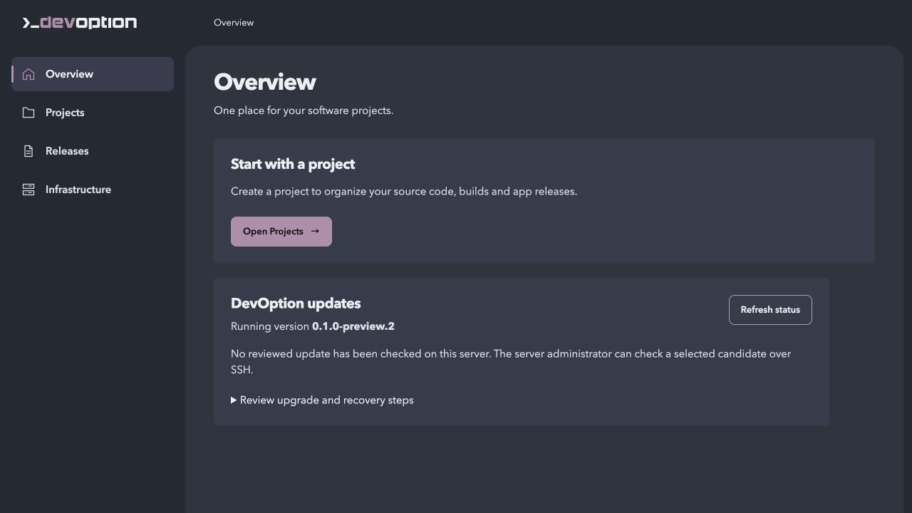
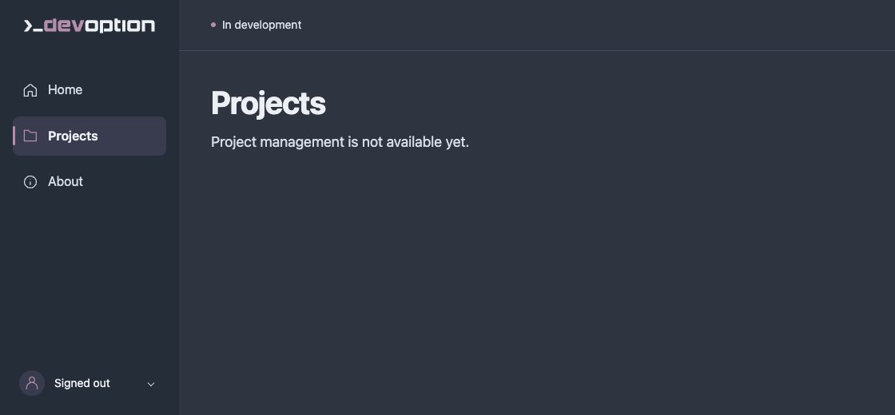

# DevOption

DevOption is an open-source software factory in development, intended to be
self-hosted for individuals and teams: one place to organize, build and run software.

The current preview supports saved projects, project creation and renaming,
repository creation, attachment, [file browsing in Code](docs/repository-files.md)
and Git status inspection,
[source preparation checks](docs/build-preparation.md) in Builds or the CLI,
owner sign-in, and appearance preferences. An opt-in [Linux build runner](docs/web-app-builds.md)
can build the selected trusted Wasm web app through review and approval in the interface.
The opt-in [private app runtime](docs/web-app-deployments.md) adds saved releases,
reviewed deployment, health/log/stop controls and restart recovery on the same node.
[App hostnames](docs/app-hostnames.md) add a separate HTTPS route and visible local TLS status. Authentication
currently supports one owner; team accounts are planned, not implemented.
There is no published release. An explicit [HTTPS proxy setup](docs/public-linux-install.md)
has [fresh cloud installation, public DNS/ACME and lifecycle evidence](docs/public-cloud-acceptance.md)
for the selected trusted app on one Ubuntu node.

## Quick start

Install Git, [Rust **1.99.0**](https://www.rust-lang.org/tools/install), and your
operating system’s C build tools/linker. Initial setup needs internet access.

```sh
git clone https://github.com/devoption/devoption.git
cd devoption
cargo fetch --locked
cargo run --locked --offline -- serve
```

Open [127.0.0.1:3000](http://127.0.0.1:3000/); press **Ctrl+C** to stop.
This starts an unconfigured development preview. For saved projects and optional
existing-repository inspection, follow [owner setup and usage](docs/using-devoption.md) or the
[private Ubuntu installation guide](docs/private-linux-install.md).
The server binds to loopback. Use the explicit [HTTPS proxy setup](docs/public-linux-install.md)
for public-origin validation; never expose the backend HTTP port.
Run `cargo run --locked --offline -- --help` for command options.

## Preview





[More screenshots](docs/screenshots/gallery.md)

## Documentation

- [Your first web app](docs/first-web-app.md) — install, build, deploy and maintain
- [Platform roadmap](ROADMAP.md) — current capabilities and planned direction
- [User guide](docs/using-devoption.md) — setup, sign-in, projects and repositories
- [Install, back up and restore](docs/private-linux-install.md) — private Ubuntu preview
- [Development and checks](docs/development.md) — architecture and validation commands
- [Documentation index](docs/README.md) — technical references and validation evidence

To contribute, start with an [issue](https://github.com/devoption/devoption/issues/new/choose)
and read [CONTRIBUTING.md](CONTRIBUTING.md).

[Changelog](CHANGELOG.md) · [Security reporting](SECURITY.md) ·
[MIT License](LICENSE) · [Sponsor DevOption](https://github.com/sponsors/devoption)
