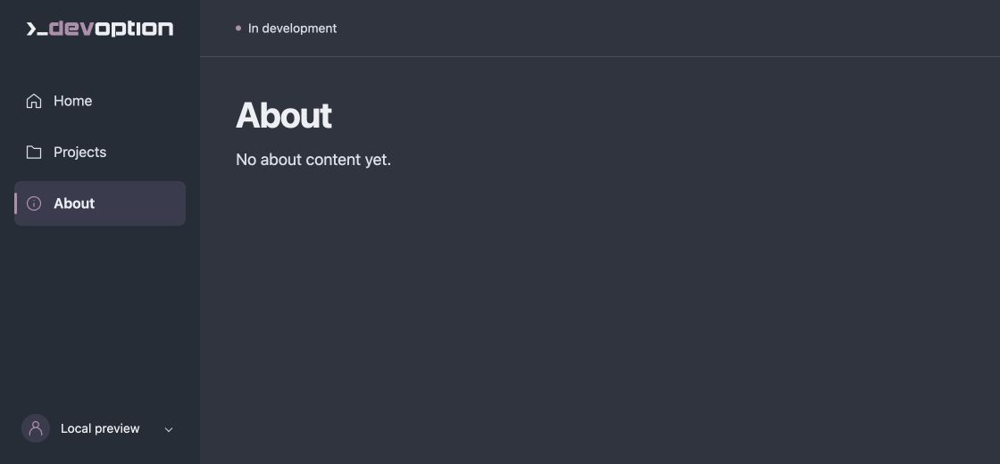
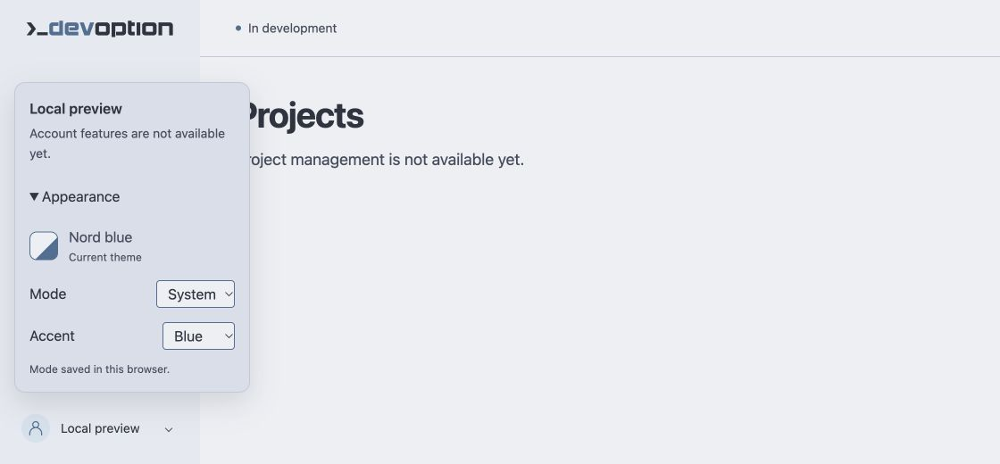

# DevOption

DevOption is an early open-source project working toward a self-hosted software
factory: a place to manage the work of building, testing, and running software.

**Today this repository is a small foundation, not a working software factory.**
It contains a Rust workspace, a command-line program with a localhost-only HTTP
server, behavioral tests, and contribution and release checks. The server shows
empty Home, Projects, and About pages in a shared sidebar layout. It does not create
files, provision infrastructure, or contact a service. There is no installer,
project management, runtime cluster, or published release yet.

## Screenshots

These are the current local Home, Projects, and About pages in the default dark
mode. All are empty placeholders; the screenshots show the shared shell.

**Home (`/`)**


**Projects (`/projects`)**


**About (`/about`)**



**Appearance (System following a light device preference, blue accent)**



See the [capture instructions](docs/screenshots/README.md) when updating the UI.

## Try it locally

You need Git, Rust **1.99.0**, and your operating system's C build tools/linker.
Use the [official Rust installation guide](https://www.rust-lang.org/tools/install)
if Rust is missing; it explains platform prerequisites. With rustup installed,
the checked-in `rust-toolchain.toml` selects the version and components
automatically. An existing system Rust installation at the same version also works.
The first rustup setup and dependency fetch need internet access. After fetching
the locked dependencies, builds and tests can run offline.

In a terminal:

```sh
git clone https://github.com/devoption/devoption.git
cd devoption
cargo fetch --locked
cargo run --locked --offline -- --help
cargo run --locked --offline -- --version
```

Help describes the scaffold's limits. The version is `devoption 0.1.0-dev`;
this identifies development source, not a release. Running without arguments
also shows help. Unsupported commands (such as `start`) exit with code 2 and
an error on standard error.

## Run the local server

From the repository folder, after the setup above:

```sh
cargo run --locked --offline -- serve
```

Wait for `Listening on http://127.0.0.1:3000 (Ctrl+C to stop)`. In a second
terminal, run:

```sh
curl --include http://127.0.0.1:3000/
```

Open **http://127.0.0.1:3000/** in your browser. Home (`/`), Projects (`/projects`),
and About (`/about`) share a sidebar and header, with the current page marked.
All three pages are clearly empty placeholders; there are no project controls
or data yet.

The sidebar uses the approved DevOption SVG. Its `dev` lettering follows the
selected primary accent from the basic [Nord palette](https://www.nordtheme.com/docs/colors-and-palettes/);
light mode uses darker counterparts for contrast.
Shared color, spacing, and typography values live in
`crates/devoption-ui/assets/theme.css`. The profile button opens a small local-preview
popup. Open **Appearance**, then choose **Dark**, **Light**, or **System** under
**Mode**, and **Purple**, **Blue**, or **Green** under **Accent**. Dark and Purple
are the defaults.
System follows the device color scheme reported by your browser, including changes
while the page is open. It keeps your chosen accent. Explicit Dark and Light choices
stay fixed when the device preference changes.
Each choice is saved only in this browser for this address and port; it applies
when navigating or reloading. Other open tabs pick it up when reloaded. Missing
or invalid values use that setting's default without resetting the other choice.
Existing saved mode choices are preserved. If browser storage
is blocked or full, the page stays usable and Appearance explains any read/save
failure; an unsaved change lasts only for the current page. JavaScript is required
to change either setting; without it, the pages still work in dark mode with Purple.

Account features and additional palettes are not implemented. The popup uses
native HTML popover support in modern browsers; Escape or a click outside closes
it. On narrow screens, navigation moves above the content.

GET returns HTTP 200 with HTML for each page; HEAD returns headers without a
body. Unknown paths return 404; unsupported methods on these pages return 405.
Malformed HTTP requests are rejected by the HTTP library.

Press **Ctrl+C** in the server terminal to stop the process. This increment does
not implement graceful request draining. If the port is busy, startup exits with
code 1 and an error. Choose another port with
`cargo run --locked --offline -- serve --port 3001`. Port `0` selects a free port
and prints the actual address. Invalid ports/options exit with code 2.

After changing source files, stop the server, rerun the same command, and refresh
the browser. The preview shows your current checkout; automatic reload is not
implemented.

The address is always IPv4 loopback (`127.0.0.1`); there is no host/bind option.
This server is for local development, with no authentication or TLS. Do not
expose it through a proxy or use it as a production service.

## Build and check

Run these commands from the repository folder after `cargo fetch --locked`:

```sh
cargo build --workspace --locked --offline
cargo test --workspace --locked --offline
cargo fmt --all -- --check
cargo clippy --workspace --all-targets --locked --offline -- -D warnings
```

The executable is `target/debug/devoption` (`devoption.exe` on Windows).
Tests exercise the actual command's help, version, and invalid-input behavior,
plus real loopback HTML/navigation responses, HTTP errors, and an occupied-port failure.
GitHub CI runs on Ubuntu; local validation also covers macOS. Windows is not yet
covered by CI.

Repository automation uses Python **3.11 or newer**, with no external Python
packages. To check it too:

```sh
python3 -m unittest discover -s scripts -p 'test_*.py'
```

Appearance checks use Node.js **22.22.3** (the version pinned in CI), with no npm
packages or installation step beyond [Node.js](https://nodejs.org/en/download).
Node is only needed for these tests, not for building or running DevOption:

```sh
node --test scripts/test_appearance.cjs
```

These tests run the shipped browser script with storage faults and check palette
contrast. Real browser checks cover the native controls, focus, and layout.

## Where this is going

DevOption's own code will stay in **one monorepo**, split into Rust modules and
crates when real boundaries justify them. There are two crates now:

- `crates/devoption-cli` owns the command line and HTTP routes/server. It builds
  the single `devoption` executable.
- `crates/devoption-ui` owns shared HTML rendering and the CSS/SVG/JavaScript assets. It is
  a library with no external dependencies; the server wraps its HTML in responses.

Both compile into the same executable. No factory/runtime services, business
domain crate, or placeholder crates are included.

Future work may add easy self-hosted installation, a full administration and
development factory cluster, lighter runtime clusters, source control, CI,
releases, and observability. Managed projects may span multiple repositories
and share reusable internal packages. Agent access through MCP is intended to
be bounded and secure. These are design goals, not available capabilities or
delivery promises.

## Get involved

Start with a small [issue](https://github.com/devoption/devoption/issues/new/choose)
before changing code or documentation.

- [Contribution guide](CONTRIBUTING.md)
- [Changelog](CHANGELOG.md)
- [Release instructions](docs/releases.md)
- [Security reporting guidance](SECURITY.md)

DevOption is licensed under the [MIT License](LICENSE), copyright 2026 DevOption
Labs LLC.

[Sponsor DevOption on GitHub](https://github.com/sponsors/devoption).
