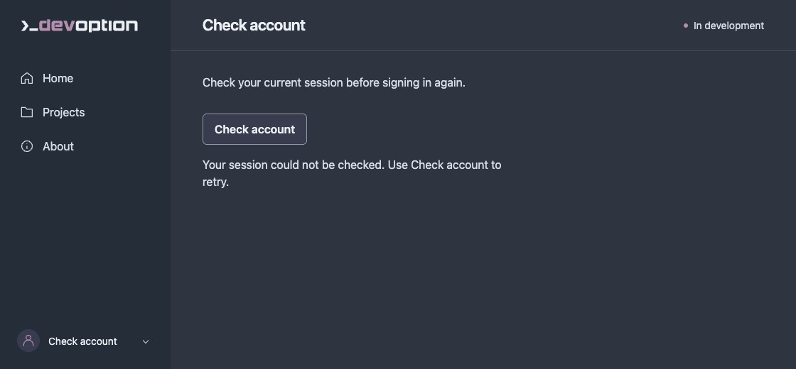

# Browser sign-in and cookie transport fixture

The unconfigured preview cannot issue browser sessions. This optional manual check
uses an ignored Rust test, a temporary private owner store with a fixture password,
and an ephemeral `127.0.0.1` listener. It changes no real account or preview settings.
It uses production authentication handlers with only a temporary fixture owner.

Run from the repository root:

```sh
cargo test -p devoption-server --lib --locked --offline manual_cookie_browser_fixture -- --ignored --nocapture
```

Open the printed URL in a fresh browser profile/context. The fixture includes the
production pages and stops after ten minutes; rerun it if necessary. The fixture
password is `browser transport fixture only`. It is never a real account password.
The owner directory also contains two example projects with two and one
repository associations. A separate temporary trusted root contains minimal
supported Git metadata fixtures named `frontend`, `backend`, `tools` and
`工具 & <fixture>`. The first two are attached to Example application; frontend
is also attached to Example documentation with the same repository identity.
Projects uses the real attachment, persistence, rendering and authentication
paths. The command prints the disposable root for fixture inspection. No real
repositories are opened and no Git command runs.

After signing in, use the Projects form to create a new fixture name with the
keyboard. It must appear with zero repositories immediately after the page reloads
and remain after another reload. Check a non-ASCII name and markup characters;
they must display as text. Invalid/oversized names must not create a row. A failed
save must retain the name and ask you to inspect the list before retrying, without
claiming success. Check the labelled form and submit button at a narrow viewport.
Capture `projects.jpg` before adding extra test records to keep the two standard
fixture rows consistent. These writes affect only the temporary fixture catalog.

Open **Example application** with the keyboard from its name link. The details
page must show only that project’s repositories and relative default checkout
paths, a **Back to Projects** link, and unavailable build execution with no build
or deploy button. Capture `project-details.jpg` before attaching more fixtures.
Check the other project and a new empty project, then a direct reload and browser
Back/Forward. Test the details page at a narrow viewport and while signed out.
A successful attachment from details must reload that same project page.

Expand a project's **Attach repository** disclosure with the keyboard, enter
`tools` and submit. Its count and default checkout list must update after the
confirmed reload and persist across another reload. Attach `工具 & <fixture>`
and verify literal text rendering. A duplicate `frontend` must preserve its
default checkout; `../escape` and a missing checkout must fail without changing
the list. Simulate an HTTP or network failure and check that the path is retained
with an uncertain-result message. Replacing a fixture checkout must produce a
stale-checkout conflict. Check labelled controls, visible focus, narrow layout,
failed session recovery and a session ended from another tab. With JavaScript
disabled, attachment fields and buttons must stay disabled.

To check the root-unconfigured state, start a fresh fixture with
`DEVOPTION_BROWSER_ROOT_DISABLED=1` before the command above. Its saved lists
remain visible, but attachment forms are absent and the page explains the need
for a server administrator to configure a trusted root. This environment switch
belongs only to the ignored test; production has no root environment fallback.

For the UI check, open `/projects` while signed out and confirm a redirect to
**Sign in** with no protected page content. Home, About and Appearance have the
same guard; `/sign-in` must remain reachable without redirecting again. Submit an
incorrect password, then the fixture password. Confirm fixed feedback, password clearing,
and keyboard focus on the error field or successful Account heading. Reload, then
navigate to another page: the profile should still offer **Sign out**. Check logout
from both the Account screen and another page's profile menu, then confirm that
reloading or directly opening a protected page redirects to Sign in. At a narrow
viewport, check labelled input, keyboard access, visible focus and no horizontal overflow.
With JavaScript disabled, the sign-in input and button must remain disabled and
the page must explain that JavaScript is required.

After sign-in returns 204, temporarily block the following `/auth/session` request
in the browser tool. The page must show **Check account**, not a signed-out state
or cookie-failure diagnosis. Remove the block and follow **Check account**: it must
recover the same live session without another challenge/sign-in request. Also check
a failed recovery on reload, an HTTP error and a response without a valid CSRF header.



For the transport check, use browser developer tools or an existing browser
automation tool to make these same-origin requests. Do not print or save tokens:

1. `POST /auth/challenge`: expect 204, an empty body, `Cache-Control: no-store`,
   a `__Host-devoption_preauth` cookie, and a separate `X-CSRF-Token` response header.
2. `POST /auth/sign-in` without the header must return 403. Then submit the header
   and `Content-Type: application/x-www-form-urlencoded` with the fixture-only body
   `password=browser+transport+fixture+only`. Expect 204 and a fresh
   `__Host-devoption_session` cookie and `X-CSRF-Token` header. Reusing the pre-session
   token must return 403. This known password belongs only to the ignored fixture.
3. Confirm both cookies are host-only, `Secure`, `HttpOnly`, `SameSite=Strict`, and
   scoped to `/`. The authenticated cookie has no persistent expiry; the pre-session
   has a five-minute maximum age. `document.cookie` must not expose either cookie.
4. `POST /probe` without the authenticated CSRF header must return 401; with that
   header it must return 204. `POST /auth/session` without an explicit CSRF header
   must return 204 with the same session CSRF token, no `Set-Cookie`, and no-store.
   This endpoint still requires the session cookie and matching Origin; it does
   not create or extend the session. Keep tokens only in temporary test memory.
5. Request another challenge and sign in again. The previous authenticated CSRF
   token must receive 401 on both `/probe` and `/auth/sign-out`, preserving the
   new session. `POST /auth/sign-out` with the current token must return 204 and
   clear the session cookie. A subsequent probe must receive 401.
6. Repeat on `localhost` at the same printed port to check the other allowed host.
   Close the isolated browser context afterward. Do not save or print tokens.

The fixture shares the five-attempt authentication limit; its initial owner setup
uses one attempt. The two sign-ins on each hostname above use the other four.
Rerun the fixture or wait for the rolling minute if further attempts return 429.

Keep browser security defaults. Unsupported Secure-cookie behavior must fail
closed; never remove `Secure` or use an insecure-browser flag to make the test pass.
Chrome 153.0.8010.48 passed this check on macOS for both loopback hostnames during
#79 validation against the production challenge/sign-in/sign-out routes. Other
browsers have not been verified; this is not a compatibility claim for all browsers.
The same Chrome version also passed the rendered sign-in/logout flow and reload
recovery during #86 validation, including stale tabs, failed requests, keyboard
navigation, disabled JavaScript and a 375-pixel viewport. This fixture does not
test browser enrollment, which remains deferred.
The automated fixture uses the production auth router to test a single-use
pre-session cookie/header pair before password parsing and sign-in, including
replay rejection and fresh authenticated credentials. Run it with:

```sh
cargo test -p devoption-server --lib --locked --offline preauth
cargo test -p devoption-cli --test server --locked --offline authentication
```

Pre-sessions grant no identity or enrollment permission. At most 16 pairs are
pending, each for five minutes; full capacity returns 503 with a `Retry-After` of
1–300 seconds, rounded up to the earliest pending expiry. A pair consumed before
that time frees capacity sooner. Every admitted submission consumes its pair even
if the password/form is invalid. The client must request another challenge to retry.
Consumed cookies are inert and the next challenge replaces them. Existing-owner HTTP routes require
an explicitly selected store with a valid owner at startup. Browser forms use the
same routes and recover the live CSRF token after reload or back/forward restoration.
First-owner setup remains an explicit local/SSH CLI operation.
Configured page reads use the same authoritative session slot with strict cookie
parsing and no CSRF header requirement; they cannot create, rotate or renew it.
The CLI tests above create only temporary fixture stores and exercise real HTTP
sign-in, rotation, logout, attempt limits, and storage errors. They do not provision
an owner in the user's preview.

There is no TLS in this loopback preview. Cookies are not isolated by port, so
other services on the same host remain inside the trust boundary. Host/Origin
checks and explicit synchronizer-token validation remain required even with
`SameSite=Strict`. The server's absolute session expiry remains authoritative;
browser cookie retention does not renew it.

References: [cookie attributes and prefixes](https://developer.mozilla.org/en-US/docs/Web/HTTP/Reference/Headers/Set-Cookie),
[synchronizer CSRF tokens](https://cheatsheetseries.owasp.org/cheatsheets/Cross-Site_Request_Forgery_Prevention_Cheat_Sheet.html#synchronizer-token-pattern).
The separate pre-session follows the
[login CSRF guidance](https://cheatsheetseries.owasp.org/cheatsheets/Cross-Site_Request_Forgery_Prevention_Cheat_Sheet.html#possible-csrf-vulnerabilities-in-login-forms).
