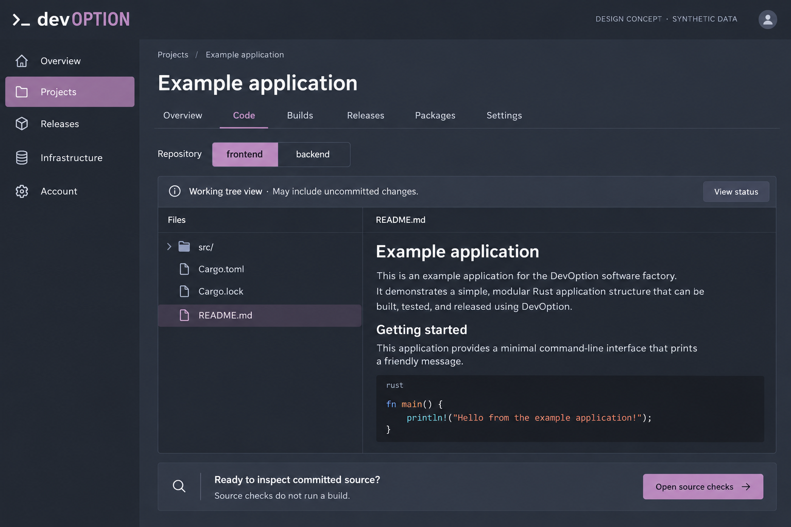
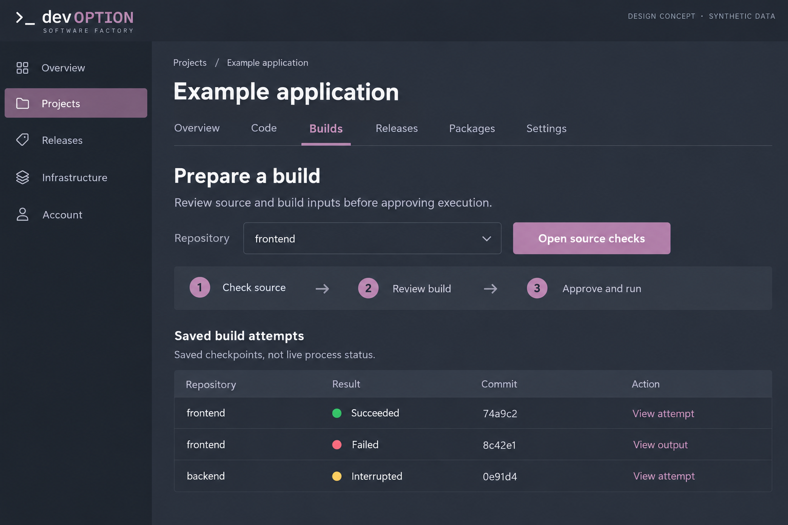
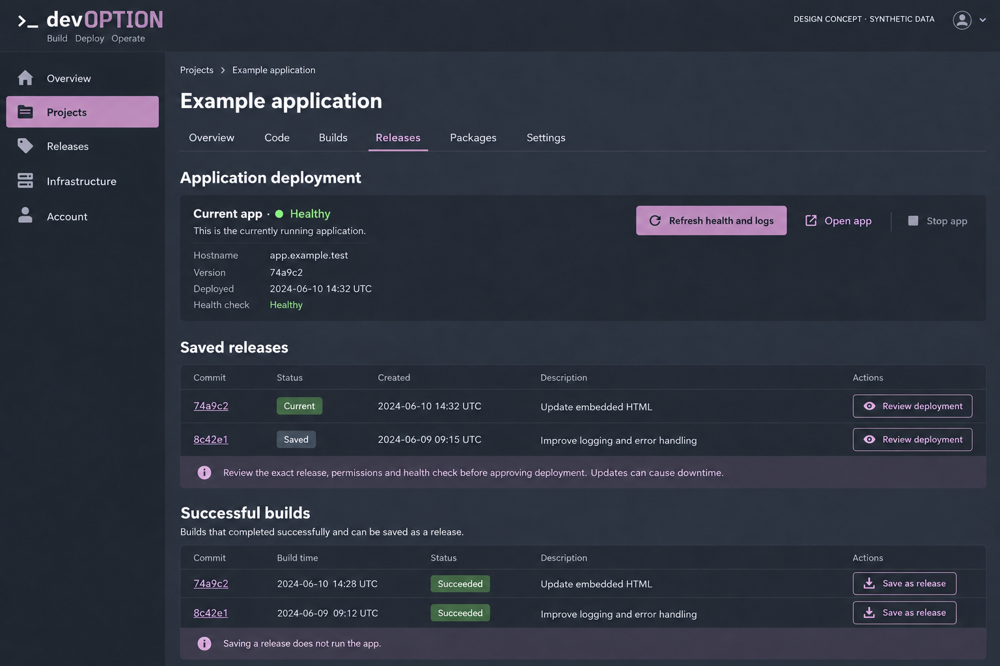

# Project workflow concepts

Three generated desktop concepts for
[#315](https://github.com/devoption/devoption/issues/315). All names, commits,
dates, statuses and app addresses are synthetic. These are proposals for owner
review, not screenshots, approved designs, working controls or implementation
evidence. No frontend code or actual page captures were changed.

## Code

Keep the tracked-file/README view and repository selector, but place the
working-tree warning beside the files and provide a clearer handoff to source
checks. The proposed **Open source checks** action is navigation; source checks
do not start compilation. No editor, commit, push or agent feature is proposed.
The sample README/code is illustrative, not a supported build target declaration.

## Builds

Lead with the next preparation step rather than making users scroll past saved
history. The sequence is **Check source → Review build → Approve and run**;
the first action cannot consume approval or start a compiler. Saved attempt
results remain clearly labeled as checkpoints, not live process status. Short
commit labels are scan aids; exact identity and inputs must remain inspectable
before approval.

## Releases

Separate the current app observation, saved releases and successful builds.
Saving a release does not run it. **Review deployment** must still open the exact
release, permissions, health-check and replacement-impact review before the
separate approval action. Returning to a saved release follows the same review
path. Synthetic Healthy status is not evidence of a real deployment or persistent
health; real observations must retain freshness and unavailable states.

## Grounding, review and limits

Inspected current Code, Builds and Releases captures and their rendering on main
`1bc5a4d`. The implemented boundaries remain authoritative in
[file browsing](../../repository-files.md), [build preparation](../../build-preparation.md),
[reviewed builds](../../web-app-builds.md) and
[deployment](../../web-app-deployments.md). The concepts rearrange those tasks;
they do not add execution authority or extend the runtime profile.

Review the source-to-build handoff, preparation-first ordering, compact history,
and separation of observation, promotion and deployment. A later implementation
issue must settle responsive layout, keyboard/focus behavior, complete identity
disclosure, empty/unavailable/stale states and action guards. No direction has
been selected here. Table descriptions and timestamps are illustrative, not new
metadata promised by current APIs.

The image generator's wordmark, icons, borders and typography are schematic.
Retain the repository's exact DevOption SVG and semantic tokens if implementing;
do not trace generated branding. Prefer spacing and solid surfaces over the
incidental outlines in the images.

Each PNG was generated with imagegen and visually inspected at 1536 × 1024.
All show the design-concept/synthetic-data label. This is static desktop review,
not responsive, accessibility, runtime or end-to-end browser acceptance. Existing
[screenshots](../../screenshots/gallery.md) remain the record of actual UI.
