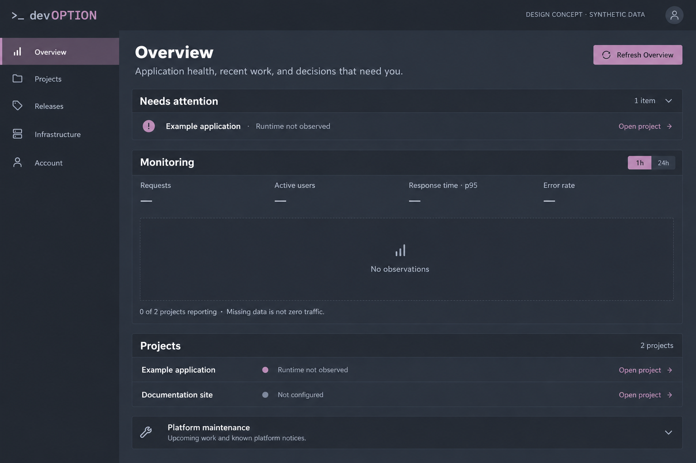

# Overview concept

Design exploration for [#352](https://github.com/devoption/devoption/issues/352).
This generated image uses synthetic data and illustrative controls. It is not a
screenshot, accepted design, implemented behavior or evidence of a running app.
No UI code or existing screenshot was changed.

## Grounding and proposed changes

Reviewed `crates/devoption-ui/src/overview.rs`, the controller's
`server/overview.rs`, the [current Overview capture](../../screenshots/home.jpg)
and [implemented monitoring contract](../../using-devoption.md#operational-overview)
on main `1bc5a4d`. The current page already has project/runtime observations,
saved build outcomes, monitoring coverage and maintenance notices.

The concept moves a concise attention item above monitoring, keeps missing
metrics as unavailable rather than drawing a success trend, and makes each
project's next navigation action explicit. Runtime-not-observed attention is a
proposal: the current attention list reports failed health and failed/interrupted
saved builds, so adopting this item would require an explicit behavior decision.
The example's missing coverage does not assert anything about a real installation.

Retain the existing DevOption branding and navigation if implementing a selected
direction. The image generator's wordmark, icons, borders and typography are
illustrative; use the repository SVG and semantic tokens rather than tracing
generated branding or introducing new assets from this mockup. Prefer spacing
and solid surfaces when translating the hierarchy into code.

## Review and limits

Review whether attention belongs first, whether the empty-state explanation is
clear, and whether the project links provide the right next step. No layout or
behavior has been selected for implementation. Image text and sample state are
proposals, not API contracts. There are no working controls in the image.

Generated with the imagegen tool and visually inspected at 1536 × 1024. The
design-concept label, missing-data message, four monitoring selectors and
separate project actions are present. This is desktop concept review only;
keyboard behavior, responsive layout, contrast and actual runtime correctness
require implementation and real browser checks in a separately scoped issue.
